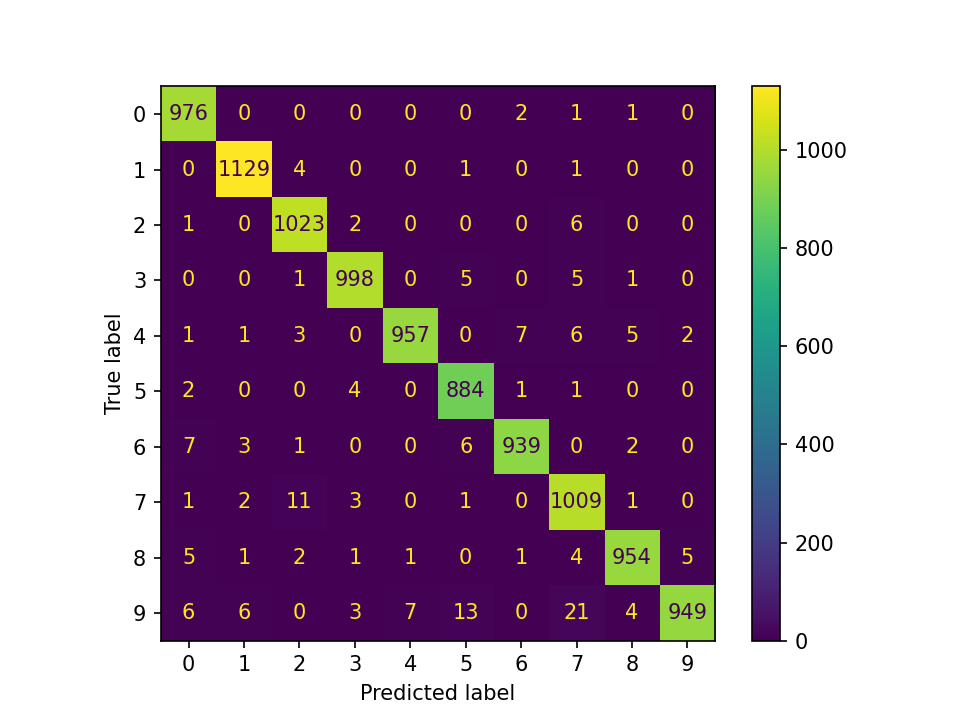

# Lab 2 – Deep Learning : Vision par ordinateur (MNIST)

**Université Abdelmalek Essaadi – FST Tanger – Cycle LSI**

**Module :** Deep Learning et Applications – Pr. El Aachak Lotfi

**Réalisé par :** Andriamasy Lorraine Agnès RAHELIARISOA

## Objectif
Prendre en main PyTorch et construire des architectures de vision
(CNN, Faster R-CNN, modèles pré-entraînés, Vision Transformer)
en mode GPU sur le dataset MNIST.

## Environnement
- Plateforme : Kaggle / Google Colab (GPU : à compléter)
- Dataset : [MNIST (Kaggle)](https://www.kaggle.com/datasets/hojjatk/mnist-dataset)

## Partie 1 : Classifieurs CNN
### 1.1 CNN from scratch

**Données.** MNIST (60 000 images d'entraînement, 10 000 de test, 28×28 en niveaux de gris),
lu depuis les fichiers IDX du dataset Kaggle. Découpage : 54 000 train / 6 000 validation /
10 000 test (graine = 42). Normalisation : moyenne 0.1307, écart-type 0.3081.

**Architecture.**

| Couche | Détail | Sortie |
|---|---|---|
| Conv2d + BatchNorm + ReLU | 1→32 filtres, kernel 3×3, stride 1, padding 1 | 32×28×28 |
| MaxPool2d | 2×2 | 32×14×14 |
| Conv2d + BatchNorm + ReLU | 32→64 filtres, kernel 3×3, stride 1, padding 1 | 64×14×14 |
| MaxPool2d | 2×2 | 64×7×7 |
| Flatten + Linear + ReLU | 3136→128 | 128 |
| Dropout | p = 0.3 | 128 |
| Linear | 128→10 | 10 |

Nombre de paramètres : **421 834**.

**Hyperparamètres.**

| Paramètre | Valeur |
|---|---|
| Optimiseur | Adam, lr = 1e-3 |
| Régularisation | Dropout 0.3, weight decay 1e-4, BatchNorm |
| Fonction de perte | CrossEntropyLoss |
| Batch size | 128 |
| Époques | 10 |
| Matériel | GPU Tesla T4 (Kaggle) |

**Résultats sur le jeu de test.**

| Accuracy | F1-score (macro) | Loss | Temps d'entraînement |
|---|---|---|---|
| 99.04 % | 99.03 % | 0.0289 | 22.6 s |

**Courbes d'apprentissage.** 

**Matrice de confusion.** 

**Analyse.**

- **Convergence.** Dès la première époque, le modèle atteint 98,03 % d'accuracy en validation. La loss d'entraînement baisse régulièrement (0.1706 → 0.0230) et l'accuracy de validation se stabilise autour de 99 % à partir de l'époque 5 (99,10 % à l'époque 10).
- **Généralisation.** L'écart entre la loss d'entraînement (0.0230) et la loss de validation (0.0382) reste faible. La loss de validation est minimale à l'époque 8 (0.0320) puis remonte légèrement aux époques 9 et 10, signe d'un début de surapprentissage très modéré. Le dropout, le weight decay et la BatchNorm le limitent efficacement. La loss de test (0.0289) est cohérente avec celle de validation.
- **Accuracy et F1.** Les deux valeurs sont quasi identiques (99,04 % et 99,03 %), ce qui est attendu : MNIST est un jeu de données bien équilibré entre les 10 classes, donc aucune classe n'est sacrifiée.
- **Erreurs.** Sur 10 000 images de test, 96 sont mal classées. La matrice de confusion montre que les confusions principales sont 3 → 5 (10 cas), 4 → 9 (9 cas), 7 → 2 (8 cas) et 9 → 8 (7 cas). Ce sont des chiffres dont les tracés manuscrits peuvent se ressembler.
- **Coût.** L'entraînement de 10 époques ne prend que 22,6 s sur GPU avec un modèle de 0,42 M de paramètres, ce qui sert de référence pour la comparaison avec Faster R-CNN et les modèles pré-entraînés.
- **Limites.** Résultats issus d'une seule exécution (graine 42), sans arrêt anticipé ni recherche d'hyperparamètres : un léger gain serait possible, par exemple en arrêtant l'entraînement à l'époque 8.
### 1.2 Faster R-CNN

**Principe d'adaptation.** Faster R-CNN est un détecteur d'objets : il prédit des boîtes
englobantes et des classes, alors que MNIST ne fournit que des labels. J'ai donc généré une
boîte par image, serrée autour des pixels non nuls (intensité > 10) du chiffre. Les classes
sont décalées de +1 (0 est réservée au fond dans torchvision), soit 11 classes au total.
Pour obtenir accuracy et F1 comparables au CNN, la prédiction d'une image est la classe de
la détection ayant le meilleur score ; une image sans détection compte comme une erreur.

**Modèle.** `FasterRCNN` de torchvision avec un backbone **ResNet18-FPN entraîné from scratch**
(sans poids pré-entraînés, BatchNorm normale, toutes les couches entraînées).
Nombre de paramètres : **28 329 606**.

**Choix d'allègement.** L'entraînement initial (ResNet50-FPN, 54 000 images) étant trop long
sur GPU gratuit, j'ai réduit le coût de calcul :

| Élément | Valeur |
|---|---|
| Données d'entraînement | 15 000 images (sous-ensemble du split de 54 000) |
| Validation | 1 000 images ; test : 10 000 images complètes |
| Taille des images | 96×96 (redimensionnement interne), 3 canaux répétés |
| Propositions de régions | 500/200 (train), 300/100 (test) au lieu de 2000/2000 et 1000/1000 |
| Échantillons par image (tête de détection) | 128 au lieu de 512 |
| Précision mixte (AMP) | oui |

**Hyperparamètres.**

| Paramètre | Valeur |
|---|---|
| Optimiseur | SGD, lr = 0.01, momentum 0.9, weight decay 5e-4 |
| Planification | warm-up linéaire sur 200 itérations |
| Gradient clipping | norme max 10 |
| Batch size | 32 |
| Époques | 3 |
| Matériel | GPU Tesla T4 (Kaggle) |

**Suivi de l'entraînement.**

| Époque | Loss train | Accuracy val | F1 val | IoU val | Temps cumulé |
|---|---|---|---|---|---|
| 1 | 0.4229 | 98.00 % | 97.96 % | 0.879 | 135 s |
| 2 | 0.1739 | 98.00 % | 97.97 % | 0.912 | 261 s |
| 3 | 0.1283 | 98.10 % | 98.09 % | 0.926 | 395 s |

**Résultats sur le jeu de test.**

| Accuracy | F1-score (macro) | IoU moyen | Loss totale* | Loss classifieur* | Temps d'entraînement |
|---|---|---|---|---|---|
| 98.18 % | 98.17 % | 0.924 | 0.1250 | 0.0583 | 395.4 s |

\*Calculées sur les 2 000 premières images de test (accuracy, F1 et IoU : 10 000 images).
La loss totale est la somme de 4 termes (RPN objectness, RPN box, classifieur, régression des boîtes).

**Courbes d'apprentissage.** 

**Matrice de confusion.** 

**Exemples de détections** (vert : boîte réelle, rouge pointillé : meilleure détection).

**Analyse.**

- **Convergence.** La loss d'entraînement diminue nettement (0.4229 → 0.1283) et l'IoU de
  validation progresse (0.879 → 0.926) : le modèle localise de mieux en mieux le chiffre.
  L'accuracy de validation reste proche de 98 % dès la première époque.
- **Un modèle encore sous-entraîné.** La loss baisse toujours à l'époque 3 : quelques époques
  supplémentaires amélioreraient probablement les résultats, mais le temps de calcul était limité.
- **Erreurs.** Sur 10 000 images de test, 182 sont mal classées. Les confusions les plus
  fréquentes concernent le chiffre 9 : 9 → 7 (21 cas), 9 → 5 (13 cas), puis 7 → 2 (11 cas).
  Ce sont des chiffres dont les tracés peuvent se ressembler.
- **Remarque sur la métrique.** Ici, l'accuracy mesure le pipeline complet (propositions,
  localisation, classification) et non la classification seule, ce qui rend la tâche plus dure
  que pour le CNN.

### 1.3 Comparaison CNN vs Faster R-CNN

| Critère | CNN | Faster R-CNN |
|---|---|---|
| Accuracy (test, 10 000 images) | **99.04 %** | 98.18 % |
| F1-score macro (test) | **99.03 %** | 98.17 % |
| Images mal classées | **96** | 182 |
| Loss (test) | 0.0289 (cross-entropy) | 0.1250 (totale) / 0.0583 (classifieur) |
| Temps d'entraînement | **22.6 s** | 395.4 s |
| Paramètres | **421 834** | 28 329 606 |
| Données d'entraînement | 54 000 images | 15 000 images |
| Époques | 10 | 3 |
| Sortie | classe | classe + boîte englobante (IoU moyen 0.924) |

**Précautions de lecture.**

- Les deux loss ne sont pas comparables : la cross-entropy du CNN porte sur 10 classes, celle de
  Faster R-CNN additionne 4 termes. La loss du classifieur (0.0583) est la plus proche de la
  cross-entropy mais reste mesurée sur des propositions de régions et sur 2 000 images seulement.
- La comparaison n'est pas à armes égales : Faster R-CNN a vu 3,6 fois moins d'images et
  3 fois moins d'époques que le CNN (allègements imposés par le temps de calcul).
  Accuracy, F1 et temps restent des indicateurs directement lisibles.

**Conclusion.**

- Le **CNN est meilleur sur toutes les métriques de classification** (+0.86 point d'accuracy,
  presque deux fois moins d'erreurs) tout en étant **environ 17 fois plus rapide** à entraîner
  et **67 fois plus petit**.
- Cela s'explique par le fait que MNIST est une tâche de classification : une seule image,
  un seul chiffre centré, sans besoin de localisation. Le CNN y est directement adapté, alors
  que Faster R-CNN dépense l'essentiel de sa capacité à proposer des régions et à régresser
  des boîtes.
- Faster R-CNN apporte une information que le CNN ne fournit pas (la position du chiffre,
  avec un IoU moyen de 0.924) et son accuracy de 98,18 % reste élevée malgré un entraînement
  réduit. Il serait pertinent pour des images contenant plusieurs objets ou des chiffres à
  localiser, pas pour MNIST seul.
- Pour la classification pure sur MNIST, le CNN est le meilleur compromis précision / coût.
### 1.4 Fine-tuning (VGG16, AlexNet)
_À compléter._

## Partie 2 : Vision Transformer (ViT)
_À compléter._

## Comparaison globale et conclusion
_À compléter._

## Synthèse personnelle
_Ce que j'ai appris pendant ce lab._
