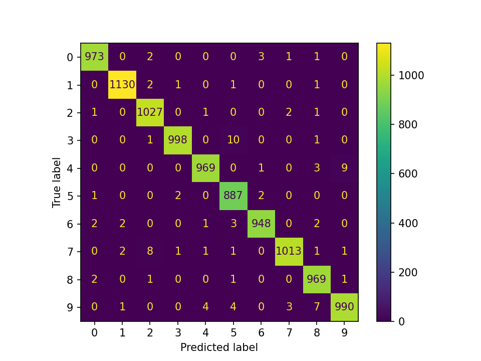

# Lab 2 – Deep Learning : Vision par ordinateur (MNIST)

**Université Abdelmalek Essaadi – FST Tanger – Cycle LSI**

**Module :** Deep Learning et Applications – Pr. El Aachak Lotfi

**Étudiante :** Andriamasy Lorraine Agnès RAHELIARISOA

## Objectif
Prendre en main PyTorch et construire des architectures de vision
(CNN, Faster R-CNN, modèles pré-entraînés, Vision Transformer)
en mode GPU sur le dataset MNIST.

## Environnement
- Plateforme : Kaggle / Google Colab (GPU : à compléter)
- Dataset : [MNIST (Kaggle)](https://www.kaggle.com/datasets/hojjatk/mnist-dataset)

## Partie 1 : Classifieurs CNN
### 1.1 CNN from scratch

**Données.** MNIST (60 000 images d'entraînement, 10 000 de test, 28×28 en niveaux de gris),
lu depuis les fichiers IDX du dataset Kaggle. Découpage : 54 000 train / 6 000 validation /
10 000 test (graine = 42). Normalisation : moyenne 0.1307, écart-type 0.3081.

**Architecture.**

| Couche | Détail | Sortie |
|---|---|---|
| Conv2d + BatchNorm + ReLU | 1→32 filtres, kernel 3×3, stride 1, padding 1 | 32×28×28 |
| MaxPool2d | 2×2 | 32×14×14 |
| Conv2d + BatchNorm + ReLU | 32→64 filtres, kernel 3×3, stride 1, padding 1 | 64×14×14 |
| MaxPool2d | 2×2 | 64×7×7 |
| Flatten + Linear + ReLU | 3136→128 | 128 |
| Dropout | p = 0.3 | 128 |
| Linear | 128→10 | 10 |

Nombre de paramètres : **421 834**.

**Hyperparamètres.**

| Paramètre | Valeur |
|---|---|
| Optimiseur | Adam, lr = 1e-3 |
| Régularisation | Dropout 0.3, weight decay 1e-4, BatchNorm |
| Fonction de perte | CrossEntropyLoss |
| Batch size | 128 |
| Époques | 10 |
| Matériel | GPU Tesla T4 (Kaggle) |

**Résultats sur le jeu de test.**

| Accuracy | F1-score (macro) | Loss | Temps d'entraînement |
|---|---|---|---|
| 99.04 % | 99.03 % | 0.0289 | 22.6 s |

**Courbes d'apprentissage.** 

**Matrice de confusion.** 

**Analyse.**

- **Convergence.** Dès la première époque, le modèle atteint 98,03 % d'accuracy en validation. La loss d'entraînement baisse régulièrement (0.1706 → 0.0230) et l'accuracy de validation se stabilise autour de 99 % à partir de l'époque 5 (99,10 % à l'époque 10).
- **Généralisation.** L'écart entre la loss d'entraînement (0.0230) et la loss de validation (0.0382) reste faible. La loss de validation est minimale à l'époque 8 (0.0320) puis remonte légèrement aux époques 9 et 10, signe d'un début de surapprentissage très modéré. Le dropout, le weight decay et la BatchNorm le limitent efficacement. La loss de test (0.0289) est cohérente avec celle de validation.
- **Accuracy et F1.** Les deux valeurs sont quasi identiques (99,04 % et 99,03 %), ce qui est attendu : MNIST est un jeu de données bien équilibré entre les 10 classes, donc aucune classe n'est sacrifiée.
- **Erreurs.** Sur 10 000 images de test, 96 sont mal classées. La matrice de confusion montre que les confusions principales sont 3 → 5 (10 cas), 4 → 9 (9 cas), 7 → 2 (8 cas) et 9 → 8 (7 cas). Ce sont des chiffres dont les tracés manuscrits peuvent se ressembler.
- **Coût.** L'entraînement de 10 époques ne prend que 22,6 s sur GPU avec un modèle de 0,42 M de paramètres, ce qui sert de référence pour la comparaison avec Faster R-CNN et les modèles pré-entraînés.
- **Limites.** Résultats issus d'une seule exécution (graine 42), sans arrêt anticipé ni recherche d'hyperparamètres : un léger gain serait possible, par exemple en arrêtant l'entraînement à l'époque 8.
### 1.2 Faster R-CNN
_À compléter._
### 1.3 Comparaison CNN vs Faster R-CNN
| Modèle | Accuracy | F1-score | Loss | Temps d'entraînement |
|--------|----------|----------|------|----------------------|
| CNN | | | | |
| Faster R-CNN | | | | |
### 1.4 Fine-tuning (VGG16, AlexNet)
_À compléter._

## Partie 2 : Vision Transformer (ViT)
_À compléter._

## Comparaison globale et conclusion
_À compléter._

## Synthèse personnelle
_Ce que j'ai appris pendant ce lab._
